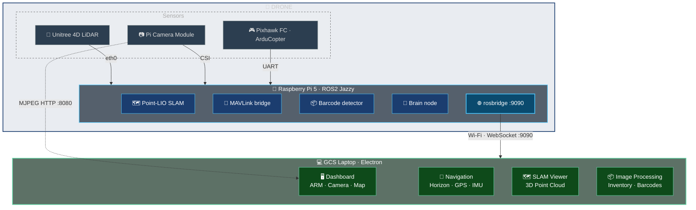
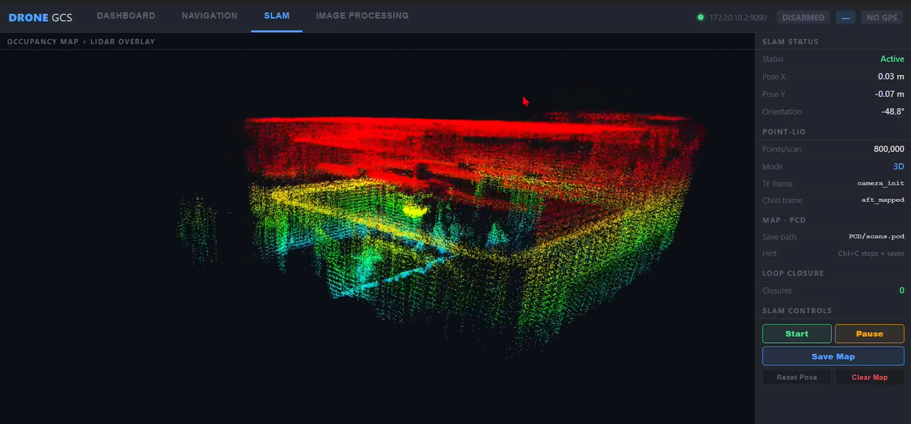
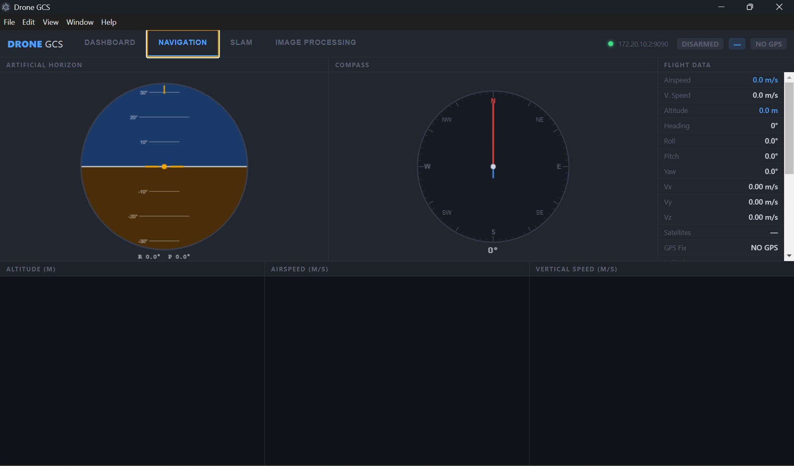
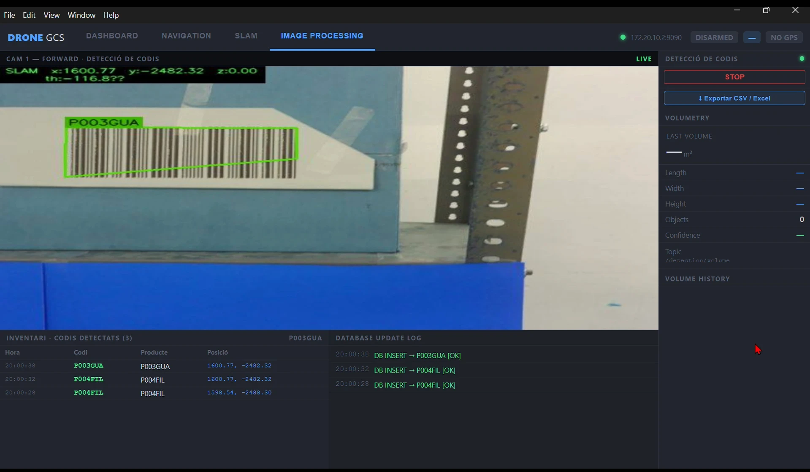
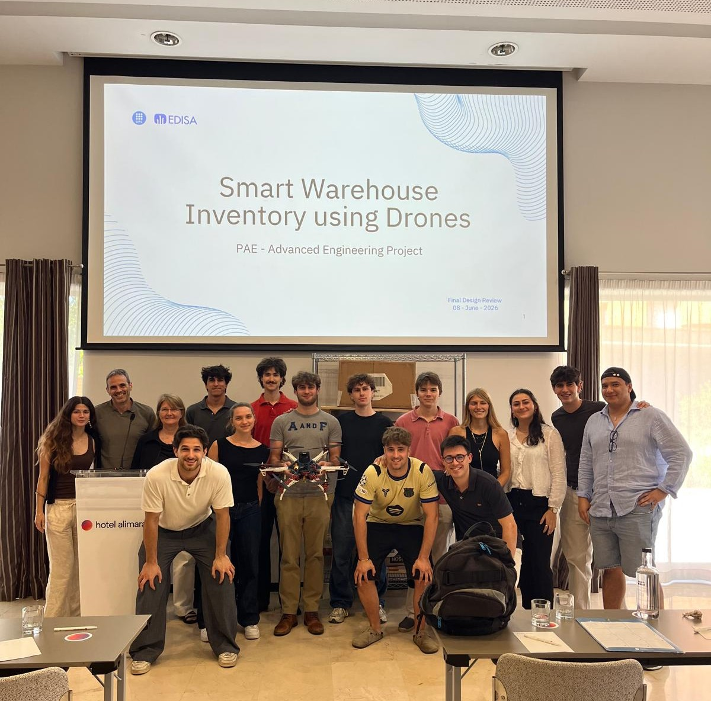

# PAE-EDISA 2026

> **Autonomous UAV system for warehouse inventory and 3D mapping** — built for EDISA as part of the UPC PAE programme (2025–2026).

A drone equipped with a LiDAR sensor, camera, and onboard computer flies autonomously through a warehouse, builds a real-time 3D map, detects barcodes and packages, and generates a geolocated inventory report — all without manual operation.

---

## Repository Layout

Organised by what each part is and where it runs (until Oct 2026 it was split into `WP2/`, `WP3/` and `src/` — see [`docs/estado/REORGANIZACION.md`](docs/estado/REORGANIZACION.md) for the old → new map).

| Folder | Runs on | Description |
|---|---|---|
| [`ros2/`](ros2/) | Raspberry Pi / simulator | All ROS 2 packages, built with colcon |
| ├ `dron_control/` | | Package `dron_control_sistema`: PX4 control via MAVROS, mission (`cerebro_node`, `mision.json`), SLAM→PX4 bridge |
| ├ `dron_percepcion/` | | Pi camera, barcode detector, image+pose sync |
| ├ `dron_gcs_bridge/` | | Nodes serving the GCS app: service manager, MAVLink bridge, mission planner |
| ├ `dron_bringup/` | | Launch files and config (MAVROS for PX4, TFs, PX4 params) — empty for now |
| └ `third_party/` | | Point-LIO (with local changes) and the Unitree L2 driver (copied, not submodules) |
| [`raspberry/`](raspberry/) | Raspberry Pi | Start scripts, systemd services, MJPEG server, `deploy.sh` |
| [`gcs/`](gcs/README.md) | Laptop | Electron ground control app |
| [`vision/`](vision/README.md) | Laptop | Computer vision: box detection, volumetry, barcodes (formerly WP3) |
| [`sim/`](sim/README.md) | Laptop | Simulation (PX4 SITL setup, Monte Carlo results) |
| [`tools/`](tools/README.md) | Any | Debugging and network test scripts |
| [`docs/`](docs/) | — | `setup/`, `arquitectura/`, `estado/`, `entregables/` |
| [`data/`](data/README.md) | — | Large data kept out of git (rosbags, maps, weights) |

---

## System Overview



---

## Key Results

- **Live 3D mapping** at 800,000 LiDAR points per scan using Point-LIO SLAM
- **Real-time barcode detection** with SLAM-tagged x/y/z position per scan
- **Autonomous waypoint navigation** driven by brain_node + Pixhawk MAVLink
- **Cross-platform desktop app** (Windows / Linux / macOS) — zero ROS needed on the laptop
- **SQLite inventory database** with CSV/Excel export

---

## Video Demo

<p align="center">
  <a href="gcs/docs/assets/demo.mp4">
    
  </a>
  <br/><em>▶ Click to watch the demo video</em>
</p>

---

## Screenshots

<p align="center">
  
  
</p>
<p align="center">
  
  
</p>

---

## Quick Start

```bash
# 1 — Deploy onboard software to the Raspberry Pi
./raspberry/deploy.sh raspi5@<PI_IP>          # ROS 2 packages → ~/slam_ws on the Pi
scp raspberry/* raspi5@<PI_IP>:~/
ssh raspi5@<PI_IP> "pip3 install --break-system-packages flask opencv-python pyzbar pymavlink"
ssh raspi5@<PI_IP> "sudo systemctl enable --now rosbridge.service"

# 2 — Launch the GCS app (laptop)
cd gcs
npm install
npm start
```

---

## Tech Stack

**Onboard (Raspberry Pi 5):** ROS2 Jazzy · Point-LIO SLAM · pymavlink · picamera2 · OpenCV · pyzbar · Flask · rosbridge  
**Ground app:** Electron · Node.js · ROSLIB.js · Chart.js · Leaflet · SQLite3  
**Comms:** MAVLink v2 (UART) · rosbridge WebSocket · MJPEG HTTP  
**Vision:** YOLOv8 · OpenCV · pyzbar

---

## Team

UPC — Universitat Politècnica de Catalunya  
PAE (Projecte d'Aplicació a l'Empresa) 2025–2026  
Client: EDISA

---

## Contributors

<p align="center">
  
  <br/><em>The Team</em>
</p>

**Students**

Aaron Noguera · Aitor Pitarch · Alejandro de Alvarado · Alejandro Jové · Clara Jorba · Ignacio Blasi · Ignasi Fernández · Jaqueline Khalioulline · Lluís Estapé · Diego Rivas · Marc Elvira · Pablo Sánchez · Patricia Ballester · Samantha Wroblewski

**Professors**

Elisa Sayrol · Javier Ruiz-Hidalgo
