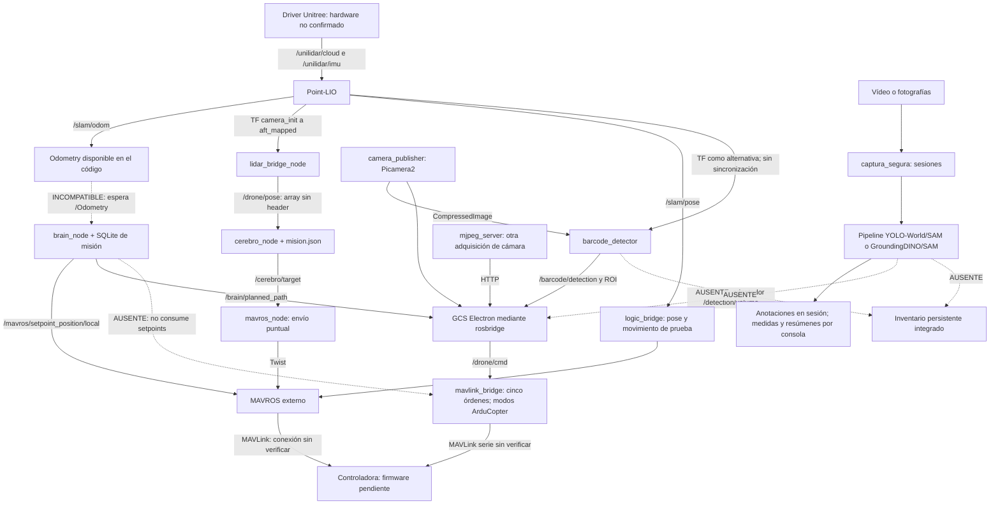
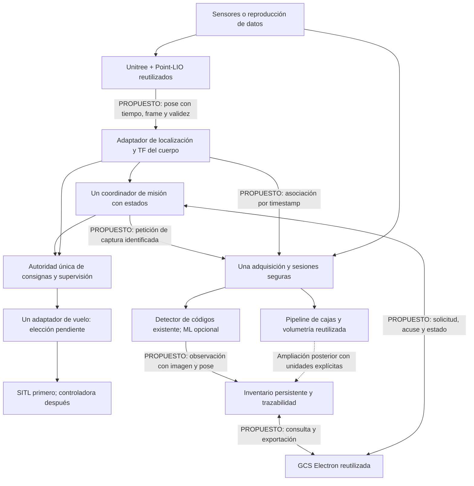

# Arquitectura actual y decisiones propuestas

**Borrador EDISA — 15/10/2026 — `feature/AiM` / `2c90052`.** Evidencias y límites: [07](07_Matriz_Evidencias.md). Las conexiones de los diagramas representan código encontrado o propuestas explícitas; no acreditan una instalación en funcionamiento.

## Arquitectura existente (AS-IS)

Existen tres recorridos principales: localización/control ROS2, cámara/códigos/GCS y visión offline. Los dos primeros comparten algunos topics, pero el repositorio no une de forma completa la misión, la captura, el procesamiento y un inventario durable.

Las flechas continuas significan interfaces implementadas, **sin verificación funcional ROS/hardware en esta auditoría**. Las discontinuas identifican rupturas o ausencias. La GCS y el detector de códigos tienen alternativa por TF; `brain_node` no la tiene. La ruta JSON puede recibir pose por TF, pero carece de un controlador automático completo.

## Mapa de conexiones reales

Estados: **I**, implementada sin verificación funcional aquí; **P**, parcial; **A**, ausente; **X**, incompatible en la configuración examinada. T01 solo verifica los recorridos de archivos de captura/visión con dobles, no el transporte ROS2.

| ID | Emisor → receptor | Interfaz y formato | Implementación actual | Estado | Cambio o validación pendiente |
|---|---|---|---|---|---|
| C01 | Unitree → Point-LIO | `/unilidar/cloud`: `sensor_msgs/PointCloud2`; `/unilidar/imu`: `sensor_msgs/Imu` | Driver `launch.py`/nodo C++; `unilidar_l2.yaml`, `laserMapping.cpp` | I | Validar campos temporales, QoS, frecuencia y datos reales; el launch del driver también abre RViz. |
| C02 | Point-LIO → consumidores de odometría | `/slam/odom`: `nav_msgs/Odometry`; alternativa `odom_only` publica `/odom_corrected` | `laserMapping.cpp`, `parameters.cpp` | I | Definir único topic, frames y calidad; no existe remapeo compatible en los lanzadores examinados. |
| C03 | Point-LIO → misión SQLite | Publica `/slam/odom`; `BrainNode.__init__` espera `/Odometry` | `brain_node.py:_on_odom` | X | Parametrizar/remapear y verificar transformación; no retocar el algoritmo de terceros para ocultar el desacuerdo. |
| C04 | TF → misión JSON | `/tf`: `tf2_msgs/TFMessage` → `/drone/pose`: `Float32MultiArray [x,y,z,yaw]` | `LidarBridgeNode._poll_tf` | P | Mantener header, fuente y validez; rechazar pose antigua; expresar pose del cuerpo del dron. |
| C05 | Misión JSON → controlador | `/cerebro/target`: `Float32MultiArray` con XYZ | `CerebroNode.pose_callback` → `MavrosNode._cb_target` | P | Autoridad start/pause/cancel, tolerancia XYZ y transmisión continua supervisada. |
| C06 | Controlador → MAVROS | `/mavros/setpoint_velocity/cmd_vel_unstamped`: `geometry_msgs/Twist`; también `/drone/cmd_vel` para simulador | `mavros_node.py:_cb_target` | P | Actualmente solo publica al recibir target; sin límites ni control periódico con feedback. |
| C07 | Misión SQLite → MAVROS | `/mavros/setpoint_position/local`: `geometry_msgs/PoseStamped`, `frame_id=map` | `BrainNode._tick`, timer nominal 10 Hz | P | Se interrumpe al avanzar/finalizar; no comprueba altura ni frescura; frame no alineado con SLAM. |
| C08 | Misión SQLite → puente propio | El anterior `PoseStamped` frente a único subscriptor `/drone/cmd` JSON | `brain_node.py` frente a `mavlink_bridge.py` | A | El puente propio no implementa receptor de setpoints; no sustituye esta función de MAVROS. |
| C09 | SLAM → estimador de controladora | `/slam/pose`: `PoseStamped` → `/mavros/vision_pose/pose`: mismo tipo | `LogicBridge.analyze_logic` | P | Se copia sin transformar ni validar. Separar los comandos de prueba que emite además; comprobar fusión del estimador. |
| C10 | GCS → órdenes de vuelo | `/drone/cmd`: `std_msgs/String` JSON | `app.js:droneCmd` → `MavlinkBridge._on_cmd` | P | Coinciden `arm`, `disarm`, `mode`, `takeoff`, `land`; faltan `goto` y `vel_stop`, rechazo explícito, identificador y acuse. |
| C11 | Controladora → GCS | MAVLink → `/drone/state`, `/drone/vfr`, `/drone/motors`, `/drone/gps_status` JSON y topics `/mavros/*` estándar | `MavlinkBridge._handle`, `app.js:subscribe` | P | Sin confirmar firmware; `GLOBAL_POSITION_INT` se copia a topic llamado `velocity_body` sin transformar el marco; headers no completos. |
| C12 | GCS → gestor de procesos | `/gcs/cmd` y `/gcs/status`: `std_msgs/String` JSON | `app.js:toggleService` ↔ `GCSControlNode` | I | Etiqueta `mavros` arranca `mavlink_bridge`; estado de proceso no significa salud del componente ni vuelo detenido. |
| C13 | Cámara → códigos y GCS | `/camera/forward/image_raw/compressed`: `sensor_msgs/CompressedImage`, JPEG, header; otra cámara opcional `/camera/down/image_raw/compressed` | `CameraPublisher._publish`, `BarcodeDetector._on_image`, `app.js:subCamImage` | I | QoS cámara/detector coincidente por código; transmisión hasta navegador y orientación por verificar. `device=1` no prueba una segunda cámara física. |
| C14 | SLAM → códigos | `/Odometry` y alternativa `/tf` | `BarcodeDetector._on_odom` / `_on_tf` | P | Topic principal incompatible; alternativa sin actualización de z; toma última pose y empieza en cero sin validez. |
| C15 | Códigos → GCS | `/barcode/detection`: JSON `barcode,code,status,slam_x,slam_y,slam_theta`; ROI comprimida | `BarcodeDetector._on_image` → `app.js:subscribe` | P | Faltan timestamp de adquisición, frame, z, ID de imagen, calidad y persistencia. `status=OK` no acredita escritura durable. |
| C16 | Captura → ambas pipelines | `Path` de sesión → enumeración directa de JPG/JPEG/PNG | `captura_segura.capturar_frames_de_video`, ambos `executar_pipeline_orquestrat` | I; recorrido con dobles aprobado | Prueba offline con códec real; estado de completitud legible por máquina. Con `--no-grabar-video`, apuntar a la sesión concreta: no busca recursivamente dentro de sesiones. |
| C17 | Pipeline → resultados locales | Anotaciones JPEG en sesión nueva; medidas como diccionario cm/cm³ y consola | BLOC0 de ambas variantes; `calcular_volumetria` | P | Inventario/medidas no guardados como registros persistentes. BLOC1 independiente conserva salidas fijas si se ejecuta en modo visual. |
| C18 | Volumetría → GCS | La GCS espera `/detection/volume`: JSON `length,width,height,volume,confidence,object_id` | `app.js:subscribe` y `updateVolumetryPanel`; sin publicador en las pipelines | A | Adaptador con conversión explícita cm→m y cm³→m³; no inventar `confidence`. |
| C19 | Imagen+pose → grabación | Topics relativos `camera/image/compressed` y `telemetry/pose_sync` | `TelemetryPublisher.timer_callback`, `ReceptorTelemetria.image_callback` | P | Cabecera copiada de última pose, no emparejamiento temporal; receptor puede guardar pose anterior y borra imágenes. No está conectado a la captura segura. |
| C20 | Observación → inventario → GCS | No existe servicio/API persistente integrado | Estados Python, array `S.barcodes`, SQLite de misión | A | Modelo mínimo de observación, escritura transaccional y consulta/exportación con reinicio verificado. |
| C21 | GCS → gestión del mapa | `/slam_toolbox/save_map`, `toggle_interactive_mode`, `clear_changes` | `app.js:slamSaveMap/slamToggle/slamResetPose` | X | Son servicios de otro sistema; Point-LIO no los implementa en este árbol. Separar limpiar la vista de borrar/guardar el mapa real. |
| C22 | Scripts → nodos instalados | `ros2 run dron_percepcion ...` / `dron_gcs_bridge ...`; paquetes propios en `~/slam_ws` | `gcs_control.py`, `raspberry/*.sh`, `setup.py` | P | Validación estática de 13 entradas aprobada; instalación y procesos sin comprobar. `deploy.sh` todavía carga Humble; arranque predeterminado Jazzy. |

## Arquitectura recomendada (TO-BE): simplificar responsabilidades

El diagrama propuesto **no está implementado**. Se conservarán algoritmos, interfaz y drivers siempre que superen pruebas; se consolidarán contratos y responsables, sin reescribir todo el repositorio.

### Alternativas y decisiones

| Decisión | Ventajas de reutilización | Inconvenientes o trabajo necesario | Propuesta provisional / confirmación |
|---|---|---|---|
| Jazzy frente a Humble | Arranque GCS usa Jazzy; nueva guía declara entorno Jazzy con SITL. Humble sigue codificado en despliegue. | No hay instalación reproducida aquí; dependencias y SO de la Pi no confirmados. | Preparar entorno de integración Jazzy si coincide con SO/equipo; no migrar a ciegas. Confirmar imagen del sistema y dependencias, resolver `deploy.sh`. |
| MAVROS frente a `pymavlink` | MAVROS encaja con `PoseStamped`, servicios y menú; el puente propio reutiliza telemetría y JSON GCS. | Puente propio no consume consignas y fija modos ArduCopter. MAVROS requiere adaptar GCS/estado y validar configuración para el firmware. | Para el SITL PX4 documentado, MAVROS es el candidato coherente. La elección para hardware queda pendiente de firmware/puertos y validación. No abrir dos controladores sobre el mismo enlace. |
| `brain_node` frente a `cerebro_node` | El primero aporta SQLite/progreso y timer de posición; el segundo conserva misión JSON y recorrido existente. | Ambos avanzan en XY y carecen de estado operativo suficiente; sus misiones no equivalen. | Reutilizar el timer y publicación de progreso de `brain_node` como candidato; conservar/importar misión JSON mediante adaptador probado. Decidir tras prueba de un waypoint, sin controladora. |
| Puente de localización | Point-LIO ya publica pose, odometría y TF; existen dos consumidores adaptadores. | `Float32MultiArray` pierde contexto; `logic_bridge` mezcla localización y movimiento de ensayo. | Una interfaz tipada con frame, timestamp, fuente, validez y transformación sensor/cuerpo; extraer solo la responsabilidad útil posteriormente. |
| Adquisición de cámara | Picamera2 sirve ROS; captura segura protege archivos; receptor aporta imagen+pose. | Picamera2, OpenCV/MJPEG y telemetría abren rutas distintas. | Un productor de imágenes; grabador/HTTP/visión como consumidores. Integrar sesiones y asociación temporal; confirmar número y modelo de cámaras. |
| Visión | YOLO-World/SAM conserva pesos y entrada CLI; GroundingDINO conserva filtros y lógica por estantería. | Sin evaluación comparable; falta checkpoint GroundingDINO; coste computacional desconocido. | Primera demo con lector de código y una imagen conocida. Ensayar primero la variante con pesos disponibles; elegir ML por precisión/latencia medida, sin borrar la alternativa aún. |
| Persistencia | `sqlite3` ya se usa para misión; GCS ya muestra códigos y exporta CSV. | Las tablas actuales no almacenan inventario y la GCS no consulta un backend durable. | Base separada o esquema versionado de observaciones; transacciones, imagen/hash, pose completa, versión de pipeline y consulta GCS. Definir producto/caja/estantería con EDISA. |
| Arranque | Paquetes ROS2 nuevos y scripts reutilizables. | `dron_bringup` vacío; dos servicios systemd y arranques alternativos con posibles duplicados. | Un arranque por perfil: reproducción, SITL y banco; componentes de vuelo excluidos del perfil de inventario offline. |

No se adopta como hecho la explicación histórica de que MAVROS no está disponible o no sirve en Pi 5: este entorno no permite comprobarla. Tampoco se deduce firmware PX4 real de la guía de SITL ni ArduCopter real de la tabla de modos del puente.

## Primer hito de integración recomendado

**Una observación de inventario recuperable tras reiniciar, sin vuelo.** Entrada: una imagen inmutable con un código conocido y un registro de pose/timestamp conocido. Salida: sesión con imagen, hash y observación durable, consultable en GCS. Separar una ejecución con detector simulado, para verificar el contrato, de otra con ZBar real, para verificar percepción offline. No presentar la primera como lectura real del código.

Datos mínimos propuestos: `session_id`, `mission_id` opcional, `observation_id`, `image_id`, ruta/hash de imagen, timestamp de adquisición, `frame_id`, XYZ y cuaternión, origen/validez de pose, código/tipo, identificador de estantería si existe, versión del procesador y estado de escritura. La pose del dron no equivale a la posición exacta de la caja: la localización métrica del producto necesita geometría sensor/objeto o asociación a estantería.

Criterios: dos ejecuciones con salidas distintas; entradas y sesiones anteriores intactas; posición inválida identificada; relectura tras reinicio; mismo registro visible en GCS; ausencia de salida a topics de control. Ni navegación, ni volumen, ni una base maestra empresarial son requisitos de esta primera demostración.

## Condiciones previas a movimiento real

Se requieren transformaciones y unidades verificadas, pose actualizada y válida, un único emisor autorizado, consignas continuas con límites de velocidad/altura/área, control explícito de armado/modos, cancelación y recuperación tras pérdida de enlace/pose. La parada debe inhibir todos los emisores, no solo publicar un cero desde un proceso. Deben ensayarse fallos en simulación antes del banco y del entorno controlado. Esta revisión no ha ejecutado esas pruebas ni autoriza a considerar seguro el vuelo.

## Decisiones que necesita EDISA

Confirmar controladora/firmware, ordenador/SO, LiDAR y cámaras; definir identificadores y ubicación empresarial esperada; elegir ordenador de inferencia y condiciones de iluminación; acordar criterio de primera demo, responsables de seguridad y disponibilidad de datos de prueba. Después podrán cerrarse adaptador de vuelo, coordinador y despliegue.
